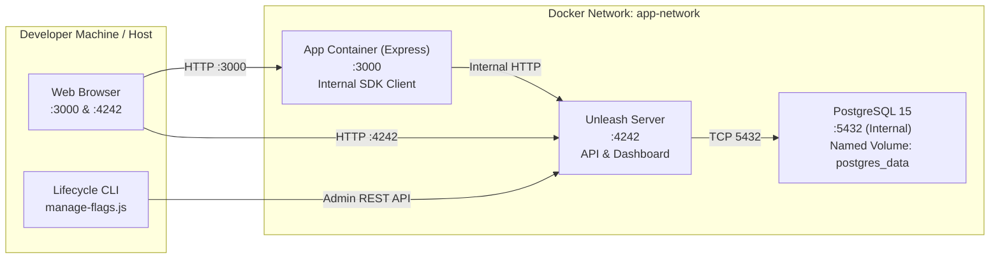

# Automated Feature Flag Lifecycle Management

This repository demonstrates automated feature flag lifecycle management for continuous delivery using **Docker Compose**, **Unleash**, **PostgreSQL**, **Node.js (Express)**, and **GitHub Actions**.

---

## 1. Architecture Overview

The local infrastructure consists of three isolated container services connected over a private bridge network (`app-network`):



### Services Specification

| Service | Image | Internal Port | Host Port | Purpose | Health Check |
| :--- | :--- | :--- | :--- | :--- | :--- |
| **`postgres`** | `postgres:15-alpine` | `5432` | *(None exposed)* | Persistent storage for Unleash configurations, flags, and tokens | `pg_isready -U unleash_user -d unleash` |
| **`unleash`** | `unleashorg/unleash-server:5.12.0` | `4242` | `4242` | Feature flag management engine, Admin UI, and client API | `wget --spider http://localhost:4242/health` |
| **`app`** | Custom (`node:20-alpine`) | `3000` | `3000` | Express application evaluating flags at runtime | `wget --spider http://localhost:3000/health` |

---

## 2. Prerequisites

- **Docker Desktop** (Engine 20.10+ / Compose v2+)
- **Node.js LTS** (v20+)
- **Git**

---

## 3. Quick Start & Setup

### 1. Configure Environment Secrets
Copy the template to create your local `.env` file (which is excluded from Git):
```powershell
cp .env.example .env
```
Ensure your database password and administrative settings are set.

### 2. Start PostgreSQL and Unleash
```powershell
docker compose up -d postgres unleash
```

### 3. Verify Container Status
Check that services are healthy:
```powershell
docker compose ps
```
Both `postgres` and `unleash` should report `(healthy)`.

### 4. Access the Unleash Dashboard
Open your browser at **[http://localhost:4242](http://localhost:4242)**:
- **Username:** `admin`
- **Password:** `unleash4all` (or your configured `UNLEASH_DEFAULT_ADMIN_PASSWORD`)

---

## 4. Feature Flag & Token Configuration

### Create the `new-dashboard` Flag
1. In the Unleash UI, navigate to **Projects** ➔ **Default** (or your CA project).
2. Click **New feature toggle**.
3. Name: `new-dashboard`, Type: `Release`.
4. In the `development` environment, toggle the switch to **Enabled**.

### Generate Tokens
In **Configure** (⚙️) ➔ **API access**:
1. **Server-side SDK (Client) Token**:
   - Type: `Client`
   - Project: `Default` / `*`
   - Environment: `development`
   - Copy token and set in `.env` as `UNLEASH_API_TOKEN`.
2. **Admin API Token** (for lifecycle scripts):
   - Type: `Admin`
   - Copy token and set in `.env` as `UNLEASH_ADMIN_TOKEN`.

---

## 5. Build and Run Application Service

With the client token configured in `.env`, build and run the application container:
```powershell
docker compose up -d --build app
```

Verify the app is running:
- Home: **[http://localhost:3000](http://localhost:3000)**
- Health Endpoint: **[http://localhost:3000/health](http://localhost:3000/health)**
- Dashboard: **[http://localhost:3000/dashboard](http://localhost:3000/dashboard)**

---

## 6. Feature Flag Lifecycle Automation CLI

The `scripts/manage-flags.js` script automates all 5 stages of the feature flag lifecycle via the Unleash Admin API:

```powershell
# 1. List all flags and their environment statuses
node scripts/manage-flags.js list

# 2. Inspect a flag's configuration and rollout strategies
node scripts/manage-flags.js get new-dashboard

# 3. Enable flag in development
node scripts/manage-flags.js enable new-dashboard development

# 4. Configure gradual rollout (e.g. 50%)
node scripts/manage-flags.js rollout new-dashboard 50 development

# 5. Disable flag in development
node scripts/manage-flags.js disable new-dashboard development

# 6. Archive / Retire flag (destructive, requires --confirm)
node scripts/manage-flags.js archive new-dashboard --confirm
```

---

## 7. GitHub Actions Workflow

The workflow at [`.github/workflows/flag-lifecycle.yml`](.github/workflows/flag-lifecycle.yml) enables remote triggering of the lifecycle CLI via `workflow_dispatch`.

> **Note on Local vs. Remote CI:**
> GitHub-hosted runners cannot reach `localhost:4242` on a developer laptop. To run the GitHub Actions workflow against a live Unleash instance, configure repository secrets `UNLEASH_API_URL` and `UNLEASH_ADMIN_TOKEN` pointing to a publicly accessible or self-hosted runner instance.

---

## 8. Persistence & Teardown

- **Standard Shutdown (Retains Database & Flag State):**
  ```powershell
  docker compose down
  ```
  Named volume `postgres_data` is preserved.

- **Restart Services (State Preserved):**
  ```powershell
  docker compose restart
  ```

- **Full Reset (Deletes Database & All Flags):**
  ```powershell
  docker compose down -v
  ```
  *(Use only when intentionally resetting the lab environment).*
